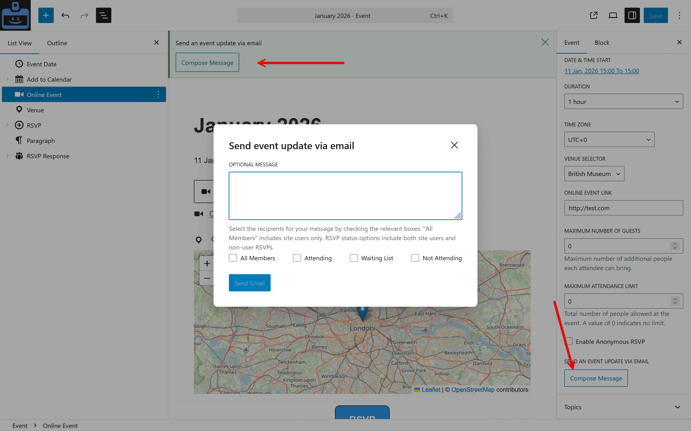

# Emails

GatherPress includes an emailing system for event communication.

Emails are sent using WordPress’ mail system (so delivery depends on your hosting and/or an SMTP plugin).

It covers different needs:

* Organizer emails to participants
    * From the event admin UI, organizers can compose a message and email specific groups linked to the event.
    * Typical recipient groups include:
        * All Members: it will email every user of the website (unless they opt-out in their profile for such messages)
        * Attendees (people who RSVPed “yes”)
        * Non-attendees (people who RSVPed “no”)
        * Waiting list (when an event has a limit)
* Site-wide messages to users
    * From **Events → Email** an administrator can message users without tying it to an event. The message can go to:
        * All users
        * Users with one or more chosen roles
        * Active users, who RSVP'd to any event in the past 30, 90, 180 or 365 days (offered while RSVPs are turned on)
    * Delivery runs on cron in batches, so a large user base is not sent in a single request and the page returns right away.
    * Users who turned event updates off in their profile are skipped.
* Waiting list promotions
    * When spots open up on a full event, people on the waiting list move to attending, and each one gets an email confirming their spot.
    * Because it is about their own RSVP, it goes out even if they turned event updates off.
* Event reminders
    * When turned on under **Settings → RSVP → Reminders**, attendees get an email a set number of hours before an event starts, 24 by default.
    * It goes to people who RSVPed "yes" only, not to the waiting list or people who declined.
    * It shows the date and time, the venue or the online link, add to calendar links, and a link to change the RSVP.
    * Users can turn reminders off in the **Notifications** section of their profile, separate from event updates. People who RSVPed without an account follow their "email me updates" choice.
    * Changing the event's start time moves the reminder, and unpublishing or trashing the event cancels it. An event published closer to its start than the reminder time gets no reminder.
* RSVP confirmation without an account (email handshake)
  See more under the [RSVP system](./rsvp-system.md) section.

